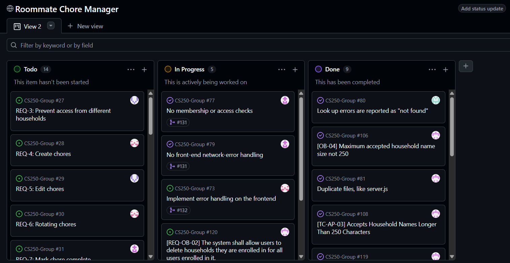

# PR4 Team Report

**Team Number:** 11  
**Project:** Roommate Chore Manager

## Team Members
- [Akshaya Pathipati]
- [Katie Le]
- [Raquel Ramos]
- [Oliver Beutz]

---

## 1. Bug Triage Table

This table documents the failing tests identified during PR4 testing and their classifications.

| Test Name | Bucket | Issue Link | Severity | Priority | Owner | Status |
|---|---|---|---|---|---|---|
| Create household with one-character values | Code Bug | [#Issue](https://github.com/Garcia-X/CS250-Group/issues/102L) | Minor | Low | Akshaya P | Done |
| Implement error handling on the frontend | Code Bug | [#Issue](https://github.com/Garcia-X/CS250-Group/issues/73) | Minor| Low | Akshaya P | Done |
| No membership or access checks | Code bug | [#Issue](https://github.com/Garcia-X/CS250-Group/issues/77) | Major | High | Katie Le | Done  |
| No front-end network-error handling | Code bug | [#Issue](https://github.com/Garcia-X/CS250-Group/issues/79) | Medium | Medium | Katie Le |Done |
| No log in feature | Missing Feature | [#Issue](https://github.com/Garcia-X/CS250-Group/issues/77) | Major | High | Katie Le | Open |
| Reject login with incorrect password | Missing Feature | [#Issue](https://github.com/Garcia-X/CS250-Group/issues/98) | Major | High | Katie Le | Open |
| Verify login response time should be 5 seconds or less | Missing Feature | [#Issue](https://github.com/Garcia-X/CS250-Group/issues/100) | Minor | low | Katie Le | Open |
| Reject login when username or password is empty | Missing Feature | [#Issue](https://github.com/Garcia-X/CS250-Group/issues/99) | Major | High | Katie Le | Open |
| Create household using an existing household name | Code bug | [#Issue](https://github.com/Garcia-X/CS250-Group/issues/103) | Major | Mayor | Raquel R |Done|
| Create household using an existing username | Code bug | [#Issue](https://github.com/Garcia-X/CS250-Group/issues/104) | Major | Major | Raquel R | Done  |
| Test runs should clean themselves | Code bug | [#Issue](https://github.com/Garcia-X/CS250-Group/issues/74) | Minor | Low | Oliver B | Done |
| Test 251 character | Code bug | [#Issue](https://github.com/Garcia-X/CS250-Group/issues/106) | Minor | Low | Oliver B | Done  |
| Users should be able delete households they are part of| Missing Feature | [#Issue](https://github.com/Garcia-X/CS250-Group/issues/121) | Major | Low | Oliver B | open |
| Users should be able view households they are part of| Missing Feature | [#Issue](https://github.com/Garcia-X/CS250-Group/issues/120) | Major | Low | Oliver B | open |

---

## 2. Regression Log

This section documents the full test suite results after each merge to main.

| Date | Fix / PR | Test That Broke | Resolution |
|---|---|---|---|
| 11/22/2026 | N/A | N/A | No regression found |

**Regression Summary:**

We ran the regression test for the first time on Sunday 11/22/2026 and all of the tests we wrote passed.

---

## 3. Final Test Run

**Date:** November 22, 2026  
**Branch:** main  
**Commit Hash:** 0d4628a

### Final Test Screenshot

### Test Results

- **Total Tests:** 4
- **Tests Passed:** 4
- **Tests Failed:** 0
- **Tests Skipped:** N/A

### Remaining Failing Tests  

All tests passed. No remaining failing tests.

---

## 4. Feature Decision

### Selected Feature

**Feature Name:** Chore dashboard

**GitHub Issue:** [#Feature Issue](https://github.com/Garcia-X/CS250-Group/issues/136 )

### User Story

As a roommate, I want a working chore dashboard, so that each person knows their responsibility to maintain a clean shared space.

### Why We Chose This Feature
Our team selected this feature (working dashboard) because this is the whole purpose of Roommate Chore Manager. The current chore manager does not have any working feature for chore management. By creating a working dashboard, users are able to add, delete, and mark chores as completed so roommates can divide and contribute to tasks.
### Team Responsibilities

| Team Member | Assigned Responsibilities |
|---|---|
| Akshaya | Create chores |
| Oliver | Make dashboard |
| Katie | Delete chores|
| Raquel | Mark chores as completed |

### Feature Test Cases

**Test Case 1: View chore dashboard**

- **Given:** A roommate joined the household and there are existing chores
- **When:** The user opens up the dashboard
- **Then:** The chores should be on display with options to add, delete, and mark chores as completed

**Test Case 2: Create a chore**

- **Given:** A roommate is on the chore dashboard
- **When:** The roommate enters chore information and submits it
- **Then:** The new chore should be displayed on the dashboard 

---

## 5. Board Snapshot

### GitHub Projects Board

**Board Summary:**

[Briefly describe the status of the team's issues and confirm that completed bug issues have been moved to Done.]

---

## 6. Sprint Summary

Household names have been restreicted to between 1 (exclusive) and 250 (inclusive) characters. automated.test.js no longer clogs the database. Redundancy of teo server.js files has been removed. Household names must be disctinct from other household names and usernames. Double-clicking submit no longer creates two households. Users can now delete household from the dashboard. There is now a membership check for joining households. There still is no dashboard nor account making. In the next sprint, we will be focusing on the dashboard.
