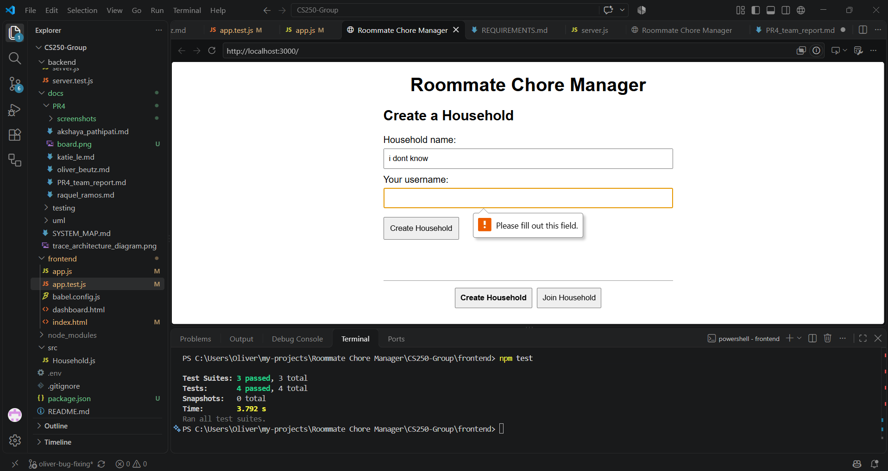

Team number and all names at the top. These sections in order:
1. Bug Triage Table: one row per failing test with these columns: Test name, Bucket, Issue link, Severity, Priority, Owner, Status
2. Regression Log: every time a fix broke an old test, list the fix, the test that broke, and how it was resolved. If nothing broke, write "No regressions found" and list the dates you ran the full suite.
3. Final Test Run: embed final_test_run.png from main after freeze. List any test still failing with a one-line reason.
4. Feature Decision: feature name, one user story ("As a ___, I want ___, so that ___"), why your team chose it, who owns which part, and 2 test cases you will use to know it works
5. Board Snapshot: embed board.png showing bug Issues in Done
6. Sprint Summary: one paragraph on what is fixed, what is still broken, and what to look at first next sprint

# PR4 Team Report

**Team Number:** 11  
**Project:** Roommate Chore Manager

## Team Members
- [Akshaya Pathipati]
- [Katie Le]
- [Raquel Ramos]
- [Oliver Beutz]

---

## 1. Bug Triage Table

This table documents the failing tests identified during PR4 testing and their classifications.

| Test Name | Bucket | Issue Link | Severity | Priority | Owner | Status |
|---|---|---|---|---|---|---|
| [Test name] | Code Bug | [#Issue](Issue URL) | Medium | High | [Name] | In Progress |
| [Test name] | Test Bug | N/A | Low | Low | [Name] | Done |
| [Test name] | Missing Feature | [#Issue](Issue URL) | Medium | Medium | [Name] | Open |

**Additional Notes:**

[Explain any test bugs that were corrected and missing features identified during testing.]

---

## 2. Regression Log

This section documents the full test suite results after each merge to main.

| Date | Fix / PR | Test That Broke | Resolution |
|---|---|---|---|
| [Date] | [PR Link] | None | No regression found |
| [Date] | [PR Link] | [Test name] | [How it was resolved] |

**Regression Summary:**

[If no regressions occurred, write "No regressions found" and list the dates when the full test suite was executed.]

---

## 3. Final Test Run

**Date:** November 22, 2026  
**Branch:** main  
**Commit Hash:** [Commit hash]

### Final Test Screenshot

### Test Results

- **Total Tests:** [Number]
- **Tests Passed:** [Number]
- **Tests Failed:** [Number]
- **Tests Skipped:** [Number, if applicable]

### Remaining Failing Tests

| Test Name | Reason It Is Still Failing |
|---|---|
| [Test name] | [One-sentence explanation] |

[If all tests pass, write: "All tests passed. No remaining failing tests."]

---

## 4. Feature Decision

### Selected Feature

**Feature Name:** [Feature name]

**GitHub Issue:** [Feature Issue](Issue URL)

### User Story

As a [type of user], I want [feature or functionality], so that [benefit or purpose].

### Why We Chose This Feature

[Explain why the team selected this feature and how it improves the Roommate Chore Manager.]

### Team Responsibilities

| Team Member | Assigned Responsibilities |
|---|---|
| [Name] | [Feature responsibility] |
| [Name] | [Feature responsibility] |
| [Name] | [Feature responsibility] |
| [Name] | [Feature responsibility] |

### Feature Test Cases

**Test Case 1: [Test Name]**

- **Given:** [Initial conditions]
- **When:** [Action performed]
- **Then:** [Expected result]

**Test Case 2: [Test Name]**

- **Given:** [Initial conditions]
- **When:** [Action performed]
- **Then:** [Expected result]

---

## 5. Board Snapshot

### GitHub Projects Board

**Board Summary:**

[Briefly describe the status of the team's issues and confirm that completed bug issues have been moved to Done.]

---

## 6. Sprint Summary

[Summarize the team's work during PR4. Include the bugs identified and fixed, regression testing results, remaining problems, and the feature selected for the final sprint. Explain what should be addressed first in the next sprint.]
