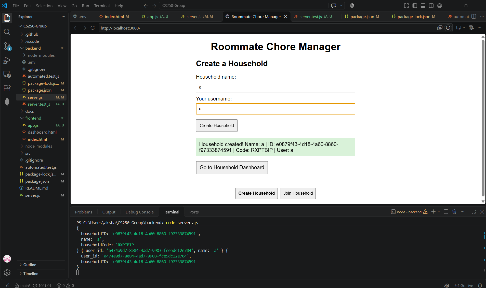
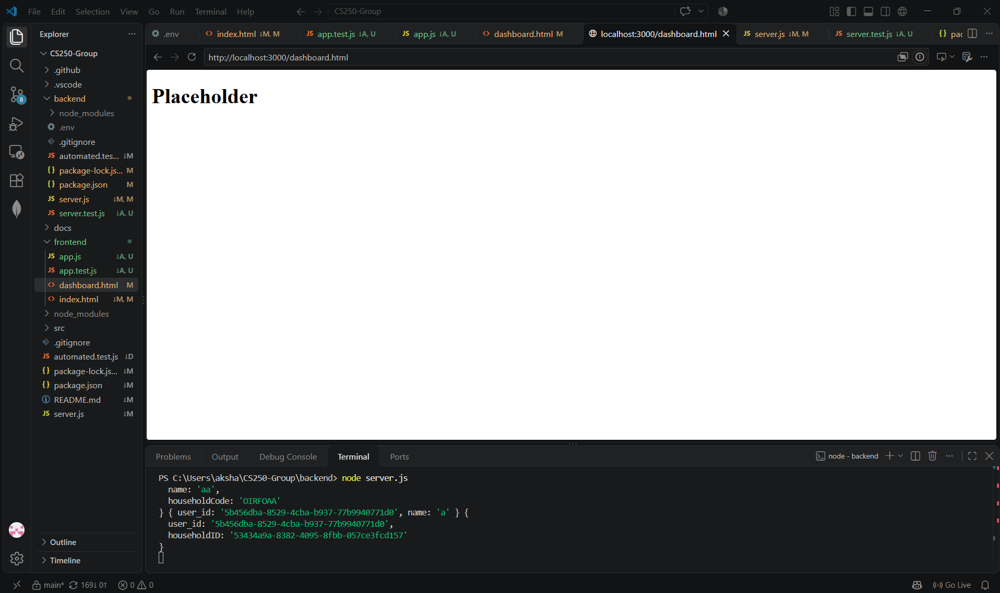
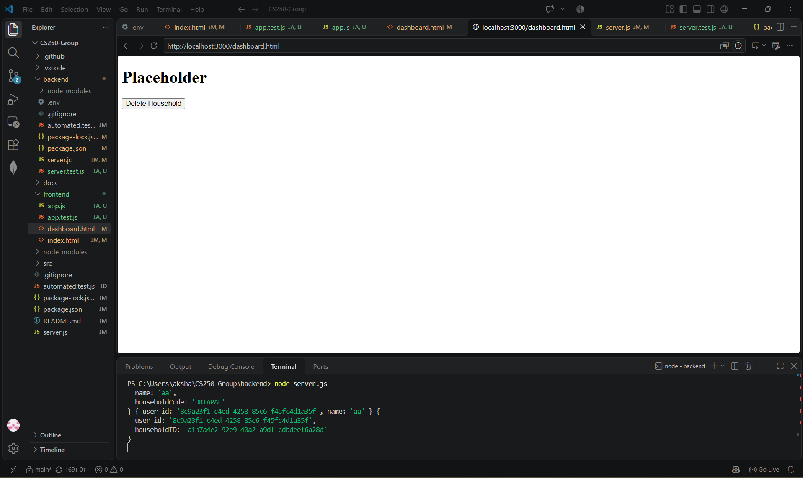

# Akshaya Pathipati

## Bug 1: Issue #102

- Issue: [GitHub Issue #102](https://github.com/Garcia-X/CS250-Group/issues/102)
- PR: [Pull Request #132](https://github.com/Garcia-X/CS250-Group/pull/132)
- Before: 
- After: 

Explanation of the bug and how it was identified.  

The bug was that the system allowed for households to be created even if the provided household name was 1 character long. This is extrapolated from Raquel's entries into the [REQUIREMENTS.md](https://github.com/Garcia-X/CS250-Group/blob/main/docs/testing/REQUIREMENTS.md). 

AI Disclosure: none

## Bug 2: Issue #120

- Issue: [GitHub Issue #73](https://github.com/Garcia-X/CS250-Group/issues/120)
- PR: [Pull Request #140](https://github.com/Garcia-X/CS250-Group/pull/140)
- Before: 
- After: 

Explanation of the bug and how it was identified.  

The system should allow for households to be deleted, but that fuctionality isn't available. We identified it by looking at the requirements that we outlined and seeing that that housholds couldn't be deleted. 

AI Disclosure: None. 
