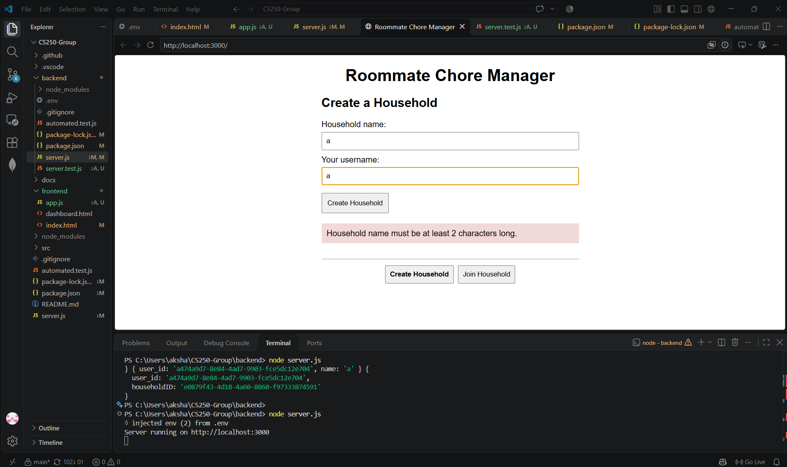

# Akshaya Pathipati

## Bug 1: Issue #102

- Issue: [GitHub Issue #102](https://github.com/Garcia-X/CS250-Group/issues/102)
- PR: [Pull Request #132](https://github.com/Garcia-X/CS250-Group/pull/132)
- Before: 
- After: 

Explanation of the bug and how it was identified.  

The bug was that the system allowed for households to be created even if the provided household name was 1 character long. This is extrapolated from Raquel's entries into the [REQUIREMENTS.md](https://github.com/Garcia-X/CS250-Group/blob/main/docs/testing/REQUIREMENTS.md). 

AI Disclosure: none

## Bug 2: Issue #N

- Issue: [GitHub Issue](LINK)
- PR: [Pull Request](LINK)
- Before: 
- After: 

Explanation of the bug and how it was identified.

AI Disclosure: [If applicable]
