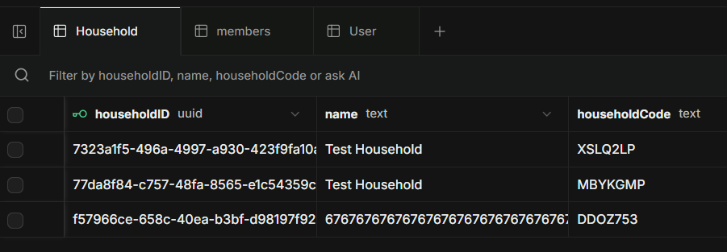
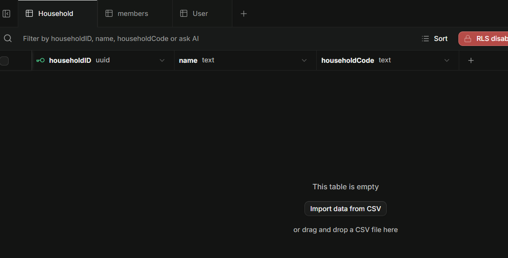
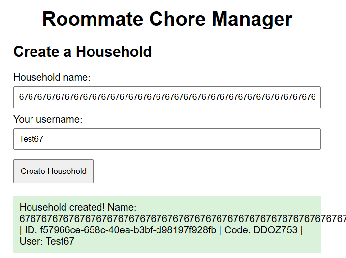
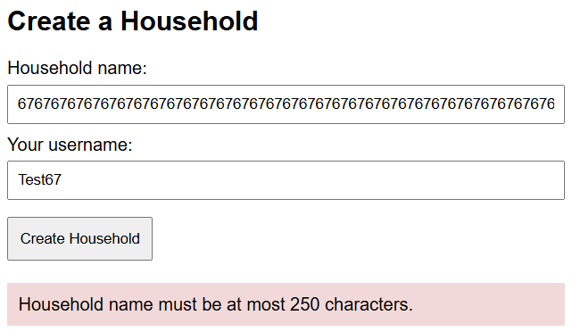

# Oliver Beutz

**Bugs Fixed:**
1. Test runs should clean themselves
- Issue Link: https://github.com/Garcia-X/CS250-Group/issues/74
- PR Link: https://github.com/Garcia-X/CS250-Group/pull/128
- Before

- After

- This is a test bug because the test suite was the thing creating the issues.
- No AI used other than Gemini overview of websites I visited anyway
2. Maximum accepted household name size not 250
- Issue Link: https://github.com/Garcia-X/CS250-Group/issues/106
- PR Link: https://github.com/Garcia-X/CS250-Group/pull/129
- Before

- After

- This is a code bug because the code has a shortcoming which inputs it allows.
- No AI used other than Gemini overview of websites I visited anyway
