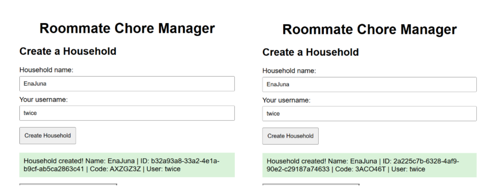

# Raquel Ramos

## Bug 1: Issue #103

- Issue: [[TC-RR-07] System should reject household names that already exist](https://github.com/Garcia-X/CS250-Group/issues/103)
- PR: [Pull Request](LINK)
- Before: 
- After: 

This was a code bug because the application
did not behave as expected.

AI Disclosure: [If applicable]

## Bug 2: Issue #104

- Issue: [[TC-RR-08] System should reject usernames that already exist](https://github.com/Garcia-X/CS250-Group/issues/104)
- PR: [Pull Request](LINK)
- Before: 
- After: 

Explanation of the bug and how it was identified.

AI Disclosure: [If applicable]
