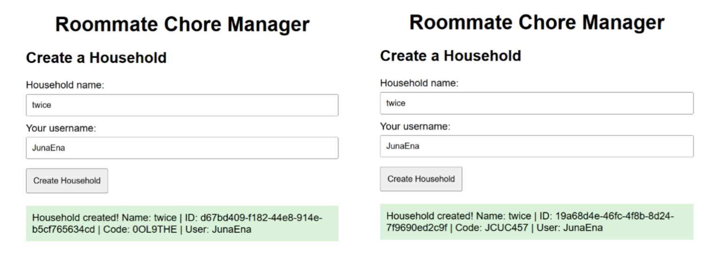

# Raquel Ramos

## Bug 1: Issue #103

- Issue: [[TC-RR-07] System should reject household names that already exist](https://github.com/Garcia-X/CS250-Group/issues/103)
- PR: [Pull Request](LINK)
- Before: 
- After: 

## Code Bug:
- This is a code bug, because there is no code that checks if the household name already exist.

AI Disclosure: [Use AI from VS code to fix small error while I code, also use ChatGPT to help me find the problem when my code didn't save.]

## Bug 2: Issue #104

- Issue: [[TC-RR-08] System should reject usernames that already exist](https://github.com/Garcia-X/CS250-Group/issues/104)
- PR: [Pull Request](LINK)
- Before: 
- After: 

## Code Bug:
- This is a code bug, because there is no code that checks if the  username already exist.

AI Disclosure: [Use AI from VS code to fix small error while I code, also ChatGPT help me create the templet for this document]
